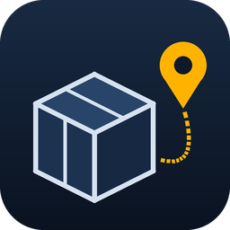
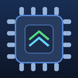

# nict41's Home Assistant Apps

[](https://my.home-assistant.io/redirect/supervisor_add_addon_repository/?repository_url=https%3A%2F%2Fgithub.com%2Fnict41%2Fnict41-s-HA-Apps)

[](LICENSE)
[](https://github.com/nict41/nict41-s-HA-Apps/actions/workflows/build.yml)

A collection of Home Assistant apps (formerly add-ons) for self-hosting,
3D printing, media and development, built and tested for Home Assistant OS.

## Installation

1. Click the **Add repository** button above, or in Home Assistant go to
   **Settings → Apps → App store**, open the **⋮** menu, choose
   **Repositories** and add:

   ```text
   https://github.com/nict41/nict41-s-HA-Apps
   ```

2. Find the app you want in the store, click it and press **Install**.
3. Read the app's **Documentation** tab for setup steps before starting it.

## Apps

| App | Description |
|:-:|---|
| <br>**[Android Dev](./android_dev)** | Android SDK, Gradle and PlatformIO builds plus wireless phone control, served to Claude Code and other agents over an authenticated MCP server.<br><sub>`amd64`</sub> |
| <br>**[Claude Code (HA Server)](./claude_code)** | [Claude Code](https://docs.anthropic.com/en/docs/claude-code) in your sidebar, based on [sproft/hass-claude](https://github.com/sproft/hass-claude), plus a Remote Control server so you can start sessions on Home Assistant from the Claude mobile app.<br><sub>`aarch64`, `amd64`</sub> |
| <br>**[ElegooSlicer](./elegoo_slicer)** | ElegooSlicer, the OrcaSlicer fork for Elegoo printers, running as a browser desktop so you can slice and send jobs from the sidebar.<br><sub>`amd64`</sub> |
| <br>**[Glance Dashboard](./glance)** | [Glance](https://github.com/glanceapp/glance), a fast self-hosted dashboard for RSS, weather, bookmarks, calendars, stocks and more.<br><sub>`aarch64`, `amd64`, `armv7`</sub> |
| <br>**[God's Eye View](./gods_eye_view)** | A photorealistic 3D globe with live aircraft, ships, satellites, earthquakes, wildfires, traffic and public cameras, with optional voice control.<br><sub>`aarch64`, `amd64`</sub> |
| <br>**[Immich Machine Learning (OpenVINO)](./immich_ml)** | Immich machine-learning sidecar using Intel OpenVINO, so a separate Immich server can run face detection and smart search on an Intel iGPU.<br><sub>`amd64`</sub> |
| <br>**[Kiwix](./kiwix)** | Offline Wikipedia and other ZIM archives: browse the Kiwix catalog, download archives to a NAS share and read them in the sidebar.<br><sub>`aarch64`, `amd64`</sub> |
| <br>**[Pantry Tracker](./pantry_tracker)** | Scan grocery barcodes to track your pantry, read use-by dates from a photo with a self-hosted vision model, and get reminders before food expires.<br><sub>`aarch64`, `amd64`</sub> |
| <br>**[Parcel Tracker](./parcel_tracker)** | Finds tracking numbers in your shipping emails (AliExpress, eBay, Amazon and more) and follows each delivery.<br><sub>`aarch64`, `amd64`</sub> |
| <br>**[Pingvin Share](./pingvin_share)** | Self-hosted file sharing (a WeTransfer alternative), built on the actively maintained Pingvin Share X fork.<br><sub>`aarch64`, `amd64`</sub> |
| <br>**[3D Print Timelapse](./print_timelapse)** | Captures a frame-by-frame timelapse of every 3D print and keeps the finished GIFs.<br><sub>`aarch64`, `amd64`</sub> |
| <br>**[Transcribe-a-bot](./ascoltino)** | Telegram bot that transcribes voice notes and shared audio files locally with Parakeet or Whisper. Based on [Ascoltino](https://github.com/soldatigabriele/ascoltino), patched to accept audio shared from other apps.<br><sub>`aarch64`, `amd64`</sub> |
| <br>**[Tube Display](./tube_display)** | Turns an IPSTube-style six-screen clock running [HA Tubes](https://github.com/nict41/HA-Tubes) firmware into a Home Assistant display, with a visual screen editor in the sidebar.<br><sub>`aarch64`, `amd64`</sub> |
| <br>**[WordPress](./wordpress)** | Self-hosted WordPress on the official image, with a built-in MariaDB database.<br><sub>`aarch64`, `amd64`, `armhf`, `armv7`, `i386`</sub> |
| <br>**[YouTube Music Sync](./youtube_music_sync)** | Mirrors the audio of public YouTube playlists into your music library, skipping tracks you already have.<br><sub>`aarch64`, `amd64`</sub> |

## Personal and niche apps

These were written for one particular setup. They work, and the
documentation explains every assumption, but check that they fit your
hardware before installing.

| App | Description |
|:-:|---|
| <br>**[Camera Share](./camera_share)** | Shares one camera as a read-only public web page, with a single connection to Home Assistant however many people watch. Built for the Elegoo Centauri Carbon 2 chamber camera.<br><sub>`aarch64`, `amd64`</sub> |
| <br>**[CPU Performance Governor](./cpu_governor)** | Sets the host CPU's scaling governor (`performance` by default) and re-applies it on every boot. Written for an Intel N100 host.<br><sub>`aarch64`, `amd64`</sub> |
| <br>**[NAS1 USB Link Watcher](./nas1_usb_watcher)** | Raises an MQTT problem sensor when a USB drive's data link drops. Written for one specific flaky drive enclosure.<br><sub>`aarch64`, `amd64`</sub> |

## Support

Found a bug or have an idea? Open an
[issue](https://github.com/nict41/nict41-s-HA-Apps/issues). Each app's
`CHANGELOG.md` lists what changed in every version.

## License

Released under the [MIT License](LICENSE), except where a folder carries
its own license (for example [`claude_code`](claude_code/LICENSE)). Apps
that package another project keep that project's license for its code.
