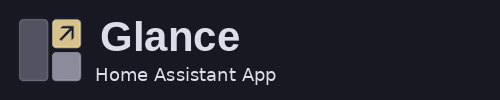

# Glance Dashboard

![Supports aarch64 Architecture][aarch64-shield]
![Supports amd64 Architecture][amd64-shield]
![Supports armv7 Architecture][armv7-shield]

[Glance](https://github.com/glanceapp/glance), a fast, lightweight self-hosted dashboard that puts all your feeds in one place, in the Home Assistant sidebar.

## Features

- RSS, weather, bookmarks, calendars, Hacker News, stocks, Twitch, YouTube, Reddit and more
- Opens in the sidebar through ingress, with no extra ports to expose
- Configuration lives in `glance/glance.yml` in your Home Assistant config folder, created on first start

## Documentation

Setup, options and troubleshooting are in the app's **Documentation** tab in Home Assistant, or in [DOCS.md](DOCS.md).

[aarch64-shield]: https://img.shields.io/badge/aarch64-yes-green.svg
[amd64-shield]: https://img.shields.io/badge/amd64-yes-green.svg
[armv7-shield]: https://img.shields.io/badge/armv7-yes-green.svg
