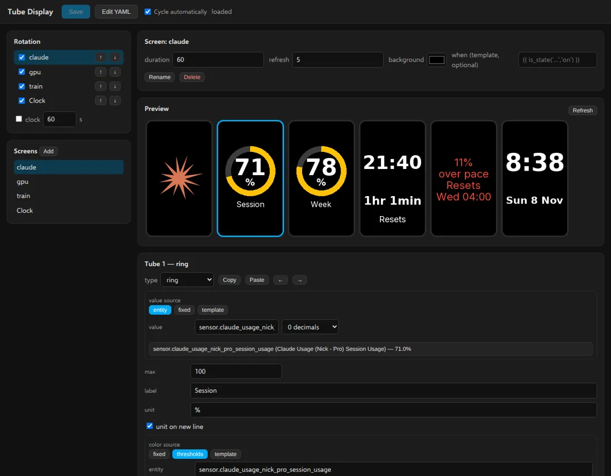
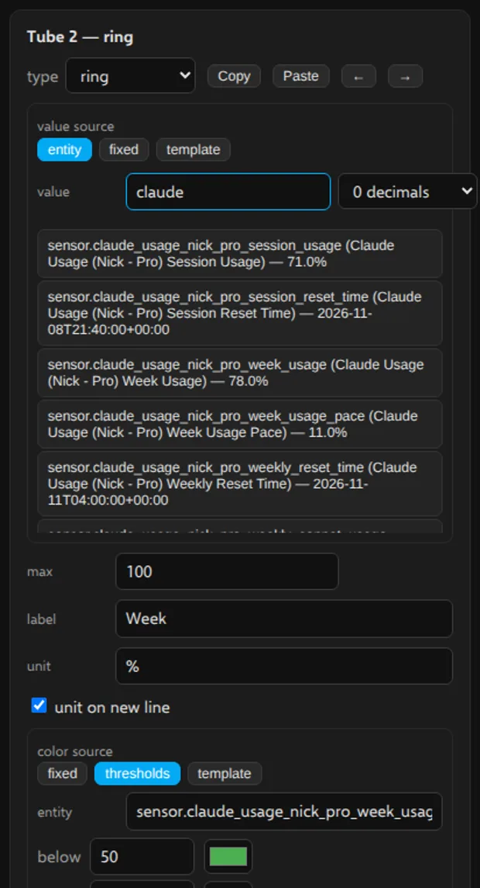
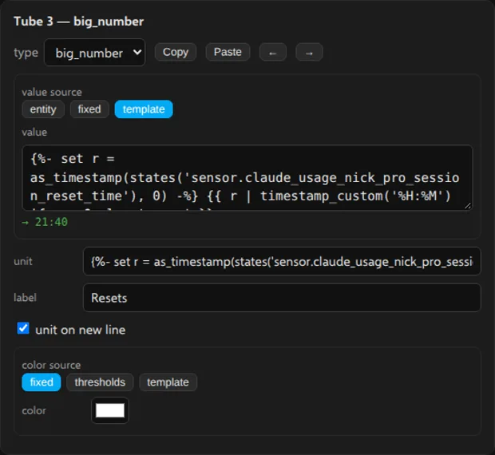
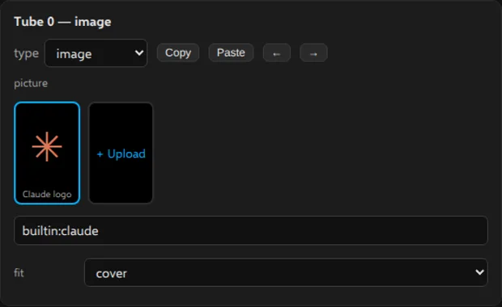

# Tube Display

Renders Home Assistant information into pictures and pushes them to an IPSTube
clock (six 135x240 colour IPS displays in a row, ESP32, custom firmware) that
runs **[HA Tubes](https://github.com/nict41/HA-Tubes)** — the clock firmware that accepts pushed pictures on
`POST http://<clock>/panel?tube=N` (install it with the [web installer](https://nict41.github.io/HA-Tubes/)). The stock time/date/weather firmware does
not accept panels.

## Options

| Option | Default | Meaning |
|---|---|---|
| `clock_host` | (example IP) | Your clock's host name or IP address (no `http://` prefix). |
| `clock_mqtt_id` | (example id) | The `<id>` in the clock's MQTT topics (`clock/<id>/...`), shown as **MQTT ID** on the clock's Info page. |
| `clock_user` / `clock_password` | empty | Optional HTTP digest auth credentials if the clock has a web login. |
| `default_duration` | `15` | Seconds a screen stays in the rotation when it doesn't set its own `duration`. |
| `default_refresh` | `30` | Seconds between re-renders of the shown screen when it doesn't set its own `refresh`. |
| `log_level` | `info` | `debug` \| `info` \| `warning` \| `error`. |
| `screens_file` | `/homeassistant/tube_display/screens.yaml` | Where the screens are kept (`tube_display/screens.yaml` in File editor). Uploaded pictures go in an `images` folder next to it. |
| `clocks` | empty | More clocks, each `{name, host, mqtt_id, user, password}`. The clock in `clock_host` is called `main`. See [Several clocks](#several-clocks). |
| `firmware_updates` | `true` | Offer new HA Tubes releases to the clocks, so Home Assistant shows a firmware update for each clock. See [Clock firmware updates](#clock-firmware-updates). |
| `firmware_variant` | `ipstube` | Which HA Tubes build the clocks run: the part after `firmware-` in the release file names. |
| `app_url` | empty | How a clock reaches this app's HTTP API, e.g. `http://192.168.8.25:8098`. Empty: the Home Assistant host's address and the host port the app's port 8098 is published on (Network settings). |

The screens file lives in your Home Assistant config folder at
`tube_display/screens.yaml` (File editor, Samba or VS Code), set by the
`screens_file` option. A commented example is written on first start if the file is
missing, and the file is **re-read automatically when it changes** — no
restart needed. A screen with an error is skipped (the error is logged and
shown in `GET /api/status` under `config_errors`); the other screens keep
working. An unknown field (a typo like `colour`) is only a **warning**: the
screen loads, the warning is logged once per load and shown under
`config_warnings` in `GET /api/status`, with a "did you mean" suggestion.

## The screens file

```yaml
rotation: [claude, doorbell, clock]   # screen names, in order; "clock" is special
clock: {duration: 60}                 # duration of the "clock" rotation entry

screens:
  claude:
    duration: 20                      # optional, default_duration
    refresh: 30                       # optional, default_refresh
    when: "{{ is_state('binary_sensor.x','on') }}"   # optional; skipped unless "true"
    background: "#000000"
    tubes:                            # exactly 6 widgets, left to right (tube 0..5)
      - {type: image, source: "builtin:claude"}
      - {type: ring, value: "{{ states('sensor.session_usage') }}", max: 100,
         label: "Session", unit: "%", color: "#D97757"}
      - {type: ring, value: "{{ states('sensor.week_usage') }}", max: 100,
         label: "Week", unit: "%", color: "#D97757"}
      - {type: text, text: "Resets\n{{ states('sensor.resets') }}", size: auto,
         color: "#FFFFFF", align: center}
      - {type: big_number, value: "{{ states('sensor.pace') }}", unit: "%", label: "Pace"}
      - {type: icon, icon: "mdi:robot", text: "{{ states('sensor.status') }}", color: "#D97757"}

  doorbell:
    strip: {source: "camera:camera.front_door", fit: cover}  # one 810x240 picture
```

A screen is either `tubes:` (exactly 6 widgets) or `strip:` (one picture
across all six tubes, `fit: cover` crops to fill, `contain` shows the whole
picture). A strip takes the same placement fields as an `image` widget, see
[Placing a picture](#placing-a-picture).

Every string field of a widget may be a Home Assistant template (`{{ ... }}`
or ``): values, labels, units, colours, sizes, even positions. They
are rendered
concurrently through the Supervisor's API (`POST /api/template`). Text fields
(labels, units, values, icon text) can have several lines: a real line break,
or `\n` typed in a one-line box. Colours
accept `#RRGGBB` (or `#RGB`) or a template returning one. If a template fails,
that widget shows a red `!` and the error is logged once per change, not on
every refresh.

### Widgets

| Widget | Fields |
|---|---|
| `text` | `text` (multi-line), `size: auto` fits the tube (or a number of pixels), `align: left\|center\|right`, `valign: top\|middle\|bottom`, `weight: bold`, `color` |
| `big_number` | `value`, `unit`, `label`, `color`, `unit_newline` — auto-sized to fit; `unit_newline: true` puts the unit on its own line so the value can be bigger. With no `unit` and no `label` the value fills the whole tube (e.g. one digit of a time per tube: `value: "{{ now().strftime('%H:%M')[0] }}"`). Optional `value_size`, `unit_size`, `label_size`, `value_color`, `unit_color`, `label_color` |
| `ring` | `value`, `max`, `label`, `unit`, `color` — circular gauge 0..max, value in the middle, label below; `unit_newline: true` puts the unit under the value. A label with several lines moves the ring to the top of the tube and uses the rest for the label. Optional `radius` (52), `thickness` (12), `value_size`, `unit_size`, `label_size`, `value_color`, `unit_color`, `label_color` |
| `bar` | `value`, `max`, `label`, `unit`, `color` — vertical bar gauge. Optional `value_size`, `label_size`, `value_color`, `label_color` |
| `icon` | `icon: mdi:<name>` (Material Design Icons), optional `text` below, `color` (default Claude orange). Without `text` the icon is centred and a little bigger. Optional `icon_size`, `text_size`, `text_color` |
| `image` | `source`: `builtin:claude` (procedural orange starburst), `file:<name>` (a picture you uploaded, see [Your own pictures](#your-own-pictures)), an `http(s)://` URL, `camera:<entity_id>` (HA camera proxy snapshot), `entity_picture:<entity_id>`; `fit`, `zoom`, `offset_x`, `offset_y`, `rotate`, `background`, see [Placing a picture](#placing-a-picture) |
| `sparkline` | `entity`, `hours` (HA history API), optional `unit`, `color` — line graph with the latest value on top |
| `graph` | `entity`, `hours` (24), `style: line\|area\|bars` (area), `label`, `unit`, `show_value` (true: the latest value big at the top), `min`/`max` (fixed axis; default from the data), `points` (bars: buckets, default 12), `color` — a history graph with the axis values at the left |
| `progress` | `value` (0..`max`, default 100), `label`, `finish` (an ISO time, a unix timestamp or `HH:MM`), `eta_format: remaining\|time` ("23 min" or "12:45"), `color`, `track` — a gauge open at the bottom with the percentage in the middle and the ETA under it. For 3D prints, washing machines, downloads |
| `analog_clock` | `tz` (e.g. `Europe/London`; default local time), `seconds` (true: a seconds hand that ticks on the clock), `numerals` (12/3/6/9 instead of tick marks), `label`, `color` (hands), `accent` (seconds hand), `face` |
| `weather` | `entity` (a `weather.*`), `show: today\|now` (today adds the day's high and low from the forecast), `label`, `color`, `icon_color` — the condition's icon, the temperature and H/L |
| `ticker` | `text` (e.g. headlines joined with " • "), `size` (28), `speed` (pixels a second, 40), `y` (the band's centre, 120), `color`, `background`, `label` — text that scrolls through a band of the tube about 10 times a second. Text that fits doesn't scroll |
| `gif` | `source: file:<name>.gif` (from the picture library, at most 135x240 and 600 KB), `loop` (true), `background`, `x`/`y` — an animated GIF played **by the clock itself** (HA Tubes 2.4 or later) at the GIF's own frame rate, with no Wi-Fi traffic while it plays. At most two `gif` tubes per screen. Older firmware shows the first frame |
| `custom` | `items`: your own layout, see [Custom tubes](#custom-tubes) |
| `blank` | empty tube |

Sizes are font sizes in pixels; leave one out (or `auto`) and the text is
fitted to its space as before.

**Fonts:** every widget that draws text has a `font` field, and a top-level
`font:` sets the default for all screens. Bundled (SIL Open Font Licence):
`bebas-neue`, `orbitron`, `share-tech-mono`, `oswald`, `jetbrains-mono`,
`nunito`, `playfair`, `press-start`, `roboto-condensed`, `audiowide`. Your own
`.ttf`/`.otf` files (**+ Upload font** in the editor, or copy them into
`tube_display/fonts/`) are `file:<name>.ttf`. `weight: bold` uses the font's bold
weight where it has one.

**Transitions:** `transition: none|cascade|cascade_right|center_out|wipe` on a
screen, or at the top level as the default, changes how a screen appears:
`cascade` changes the tubes one after another from the left (`cascade_right`
from the right, `center_out` from the middle), `wipe` draws the tubes from the
top down, each starting a moment after the one to its left. `transition_delay`
is the pause between tubes in ms (90); a wipe pauses a third of it between its
steps. Only when a screen appears, never on a refresh.

**Free design across all six tubes:** instead of `tubes` (or `strip`), a screen
can have a `canvas` with `items` placed anywhere on the 810x240 picture, the same
items as a [custom tube](#custom-tubes) with `x`/`y` across all six tubes:

```yaml
weather_wide:
  canvas:
    background: "#000000"
    items:
      - {type: icon, icon: mdi:weather-partly-cloudy, x: 67, y: 120, size: 100}
      - {type: text, text: "{{ states('sensor.outside_temp') }}°", x: 270, y: 120, size: 120, font: bebas-neue}
      - {type: bar, value: "{{ states('sensor.humidity') }}", max: 100, x: 607, y: 200, width: 380, height: 12}
```

The clock has gaps between its tubes, so keep text inside one tube or across a
gap on purpose; the editor shows where they are.

**Mistakes:** an unknown field doesn't stop a screen; it's listed as a warning
with a guess ("unknown field 'colour' — did you mean 'color'?") in the log, in
`GET /api/status` (`config_warnings`) and in the editor's status line.

### Placing a picture

A picture of any size or shape can go on a tube (135x240) or across the whole
strip (810x240). In the editor, pick the picture and drag it into place; these
are the fields that writes:

| Field | Meaning |
|---|---|
| `fit` | `cover` (default) fills the space and crops; `contain` shows the whole picture. The editor always writes `contain` |
| `zoom` | Multiplies that size: `2` is twice as big, `0.5` half. Default 1 |
| `offset_x`, `offset_y` | Move the picture's centre away from the middle, in tube pixels (right and down are positive). Default 0 |
| `rotate` | Degrees, anticlockwise. Default 0 |
| `background` | Colour behind the picture and through its transparent parts. Default: the screen's background |

```yaml
- {type: image, source: "file:holiday.jpg", fit: contain, zoom: 1.8, offset_x: -12, offset_y: 30, background: "#000000"}
```

Phone photos stored sideways are turned upright (their EXIF orientation is
applied).

### Custom tubes

A `custom` tube is a list of items you place yourself. Each item has `x` and
`y`, the position of its centre in tube pixels: `0,0` is the top left corner,
the tube is 135 wide and 240 high. Items are drawn in order, later ones on top.
It is much easier to build one in the editor's designer than by hand.

```yaml
- type: custom
  items:
    - {type: ring, x: 67, y: 62, radius: 54, thickness: 11, value: "{{ states('sensor.week_usage') }}", max: 100, color: "#4CAF50"}
    - {type: text, x: 67, y: 62, text: "{{ states('sensor.week_usage') }}%", size: 30, weight: bold}
    - {type: text, x: 67, y: 150, text: "under pace", size: 20, color: "#4CAF50"}
    - {type: rect, x: 67, y: 182, width: 90, height: 2, color: "#444444"}
    - {type: text, x: 67, y: 208, text: "Resets\nThu 10:00", size: 18}
```

| Item | Fields (besides `x`, `y`) |
|---|---|
| `text` | `text` (multi-line), `size` (pixels) or `size: auto` with `width` and `height` of the space to fit in, `weight: bold`, `align: left\|center\|right` (with `left` or `right`, `x` is that edge of the text), `color` |
| `ring` | `value`, `max`, `radius` (50), `thickness` (10), `color`, `track` (colour of the unfilled part, `none` to hide it), `start` (degrees, −90 = top, 0 = three o'clock), `sweep` (degrees, 360 = full circle; `start: 135, sweep: 270` is a gauge open at the bottom) |
| `bar` | `value`, `max`, `width`, `height`, `direction: right\|up\|left\|down`, `radius` (corner), `color`, `track` |
| `icon` | `icon: mdi:<name>`, `size` (64), `color` |
| `image` | `source`, `width`, `height` and the fields under [Placing a picture](#placing-a-picture) (default `fit: contain`) |
| `rect` | `width`, `height`, `radius` (corner), `color` — a box, or a line when it is thin |

An item that can't be drawn shows a small red `!` where it should be; the rest
of the tube still draws.

## Screen editor (ingress panel)

Open **Tube Display** in the Home Assistant sidebar (turn on *Show in sidebar*
on the app's Info tab if it isn't there).



* **Rotation** (left, or top on a phone): the order screens are shown in, with
  ↑/↓ to move them and a tick box to include each one. Screens left out stay
  listed, greyed, so you can tick them back in. The special **clock** entry
  shows the clock's own time for its duration.
* **Cycle automatically** (top bar): untick it for button-only mode, see
  [The clock's button](#the-clocks-button).
* **Screens:** **Add** opens the gallery — a *Blank screen* card plus ready-made
  screens (Clock, Weather, Now playing, 3D printer, Energy now, Next event,
  Doorbell camera, Big analogue clock), each with a live preview picture. Pick
  one, fill in its entities (searched from HA, filtered to the right domain /
  device class) and a name, watch the live preview, and **Add** puts the screen
  in the list and the rotation. **Import** pastes one or more screens (or a
  whole `screens:` file) — they are validated with the real parser, name clashes
  get " 2", " 3"…, and a tick box adds them to the rotation. A screen's
  **Export** shows it as YAML with **Copy** and **Download .yaml**. Rename or
  delete; a screen's duration, refresh, background and optional `when`
  template. **Layout** switches a screen between six tubes and one picture
  across all six.
* **Setup** (top bar) is the first-run wizard: it opens by itself while the
  screens file is still the untouched example. Step 1 lists your clocks (with
  no clock, it explains the `clock_host` / `clock_mqtt_id` options and the
  restart they need, and offers *Continue without a clock*); step 2 suggests
  gallery screens that can be filled automatically from your HA entities
  (weather, media players, energy, printer, calendar, camera — tick the ones
  you want and change the entities); step 3 sets the rotation order, the
  duration per screen (default 15 s) and automatic cycling; step 4 builds the
  screens, replaces the example (asking first if the file isn't the example)
  and saves.
* **Build…** next to the `when` field opens a small condition builder: a list
  of `[entity] [is | is not | above | below | between] [value(s)]` conditions,
  an optional *only between HH:MM and HH:MM* window (a start later than the end
  crosses midnight), combined with *all of* / *any of*. It writes the Jinja
  template (e.g. `{{ is_state('binary_sensor.door', 'on') and (states('sensor.temp') | float(0) > 20) }}`)
  and shows its live result (*true now* / *false now*). A template the builder
  wrote opens back in the builder; a hand-written one opens the builder empty
  with a note that building a new one replaces it.
* **Preview:** the screen's six tubes rendered with live values. Tap one to edit
  it. A tube with a mistake shows a red **!** and the error at the top, and
  stays editable.
* **Tube editor:** the widget type and its fields. Values and text come from an
  **entity** (search box, decimals), **fixed** text or a **template** with its
  live result. Colours are **fixed** (colour picker), **thresholds** (an entity
  plus "below N → colour" rows) or a **template**. Icon names autocomplete from
  Material Design Icons. Labels, units and sizes take fixed text or a template,
  with the template's live result underneath; press Enter in a label for another
  line. **More options** has the sizes and extra colours.
  **Copy**/**Paste** and **←**/**→** copy or move a tube.
* **Pictures:** image tubes (and one-picture screens) have a picture library
  with upload. Under it the picture is shown on the tube: drag it to move it,
  pinch, scroll or use the slider to zoom, **Whole picture** / **Fill** /
  **Centre** / **Rotate** for the usual positions, and a background colour for
  whatever the picture doesn't cover.
* **Custom tubes (designer):** change a tube's type to `custom` and what it
  showed becomes separate pieces. Drag a piece on the tube to move it, pick one
  to change its text, size and colour, and add text, rings, bars, icons,
  pictures and boxes with the **+** buttons. ↑/↓ change which piece is on top.
  **Snap to grid** makes dragged pieces land on a grid measured from the centre
  of the tube.
* **Entity names autocomplete:** type a domain and a dot (`sensor.`) in a
  template, or a few letters in an entity field, and pick from the list.
* **Save** writes `screens.yaml`; the clock picks it up within a refresh.
  **Edit YAML** shows the whole file for anything the form can't do.

Templates the form didn't create (for example multi-line Jinja) open in
template mode and are left exactly as written unless you change them.

Unknown fields (a typo like `colour` instead of `color`) are **warnings**, not
errors: the screen still loads, the status line shows *N warnings* — click it
to list them (each names its screen; click one to jump to it) — and the app
logs them once per load. At start it logs one line, e.g.
`Loaded 3 screens (0 errors, 2 warnings)`.

  

### Gallery, import, setup and conditions

- **Add** offers ready-made screens: Clock, Weather, Now playing, 3D printer,
  Energy now, Next event, Doorbell camera and a big analogue clock. Pick one,
  choose the entities it asks for, and it's added to the rotation.
- **Import** takes one or more screens pasted as YAML (from someone else, or
  from **Export**, which shows the selected screen as YAML to copy or download).
- **Setup** is a short wizard: it checks the clocks, suggests screens for the
  entities you have (a weather entity, media players, a power sensor, a printer,
  a calendar) and sets the rotation. It opens by itself while the screens file
  is still the example the app wrote.
- **Build…** next to *when* writes the condition for you: entities that are or
  aren't in a state, above or below a value, between two values, and a time
  window, combined with *all of* or *any of*. It shows whether it's true now.
- **Show on clock** in the preview card shows the screen you're editing on the
  clock while you change it, and hands back when you turn it off or leave.

### Undo, history, clocks and night mode

- **↶ / ↷** (or Ctrl+Z / Ctrl+Shift+Z outside a text box) undo and redo every
  change since the editor was opened, saved or not.
- **History** lists earlier versions of the screens file: a copy is kept
  every time you save or restore (the last 30, in `tube_display/.history/`).
  **View** shows one, **Restore** puts it back, and the restore itself can be
  undone from the same list.
- With several clocks, the **clock** picker above the rotation chooses whose
  rotation you edit: *All clocks* is the shared one, and a clock can get its
  own (or go back to the shared one). *Cycle automatically* follows the same
  choice.
- The **Night mode** card writes the `night:` block (see [Night mode](#night-mode)).
- The line at the top right shows what each clock is showing, whether it's
  live, and its brightness.

### How it works

The app registers an ingress panel **Tube Display** (`mdi:television-guide`)
in the Home Assistant sidebar. It is served by a second HTTP site on
`0.0.0.0:8099` (not published in `ports:`) that only accepts requests coming
from the ingress proxy (`172.30.32.2`); anything else gets `403`. Ingress
itself requires the HA login. The page uses only relative URLs, so it works
under the `X-Ingress-Path` prefix HA serves it at.

The editor edits the same screens file as the File editor — saves are written
atomically (temp file + rename) and the running rotation picks them up through
the existing file watcher. Saves go through a round-trip YAML load
(`ruamel.yaml`), so comments and layout survive; multi-line templates are
written as literal blocks (`|-`). If the file changed on disk since the page
loaded it, the save is refused with `409` and the page offers a Reload.

Editor API on the ingress site (all paths relative to the ingress prefix):

| Endpoint | Description |
|---|---|
| `GET api/config` | `{"yaml", "data", "mtime", "errors", "warnings", "is_example"}` — the file text, its parsed form, mtime, validation errors, unknown-field warnings, and whether the file is still the untouched example. |
| `POST api/validate` | Body `{"data": {...}}` → `{"errors": [...], "warnings": [...]}` (same validation as the loader). |
| `POST api/preview` | Body `{"screen": {...}, "tube": optional int}` → PNG of the 810x240 strip (or one 135x240 tube), rendered with the real pipeline and live HA states. Does not touch the clock or the file. For a `custom` tube the `X-Item-Boxes` header lists each item's box `[x0, y0, x1, y1]`. |
| `POST api/source_image` | Body `{"source": "..."}` → PNG of that picture (upright, at most 1620 pixels a side), used to show it while it is placed. |
| `POST api/template` | Body `{"template": "..."}` → `{"result": "..."}` or `{"error": "..."}` (live HA template render). |
| `GET api/entities?q=<text>` | Up to 50 matching `[{"entity_id","name","state","unit","device_class","domain"}]` from the Supervisor core API `GET /states` (cached ~10 s). |
| `GET api/gallery` | `{"templates": [{id, name, description, inputs}]}` — the ready-made screens (no screen bodies). |
| `POST api/gallery/build` | Body `{"id", "values": {key: entity_id}, "name"?}` → `{"name", "screen"}` — the built screen with every `[[key]]` replaced; 400 on a missing/invalid input. Not saved; name clashes get " 2", " 3"…. |
| `POST api/gallery/preview` | Body `{"id", "values"?}` → PNG of the built screen (missing inputs are filled with `domain.example` placeholders, so a template previews before its inputs are chosen). |
| `POST api/export` | Body `{"name", "screen"}` → `{"yaml"}` — the screen as it would appear under `screens:` (ruamel, same style as the saver: literal blocks for multi-line, quoted times). |
| `POST api/import` | Body `{"yaml"}` → `{"screens": {name: screen}, "errors": [...]}` — accepts `name: {...}` mappings or a whole `screens:` file; each screen is checked with the real parser; existing names get " 2", " 3"…. |
| `GET api/suggest` | `{"suggestions": [{id, name, values, why}]}` — gallery templates fillable automatically from HA's `GET /states` (the setup wizard's step 2). 503 without an HA client. |
| `POST api/save` | Body `{"data": {...}, "mtime": <from api/config>}` — 409 if the file changed on disk, 400 with errors if invalid; otherwise round-trip update and atomic write. Returns the new mtime. |
| `POST api/save_yaml` | Body `{"yaml": "...", "mtime": ...}` — raw-YAML tab; must parse and validate, then written as is. |
| `GET api/icons?q=<text>` | Up to 60 `mdi:` icon names containing the text, those starting with it first. |
| `GET api/images` / `POST api/images` | List the picture library / upload one (multipart field `file`; .png .jpg .gif .webp .bmp, ≤10 MB, checked with Pillow, saved under a safe ASCII name, never overwriting). |
| `GET api/images/<name>` / `DELETE api/images/<name>` | One picture / delete it. |
| `GET api/rotation` / `POST api/rotation` | `{"enabled": bool}` — read or set *Cycle automatically*. |

The 8098 API above is unchanged and has no write routes.

## Pushing to the clock

- `POST http://<clock>/panel?tube=N` with raw RGB565 big-endian body
  (w*h*2 bytes, default full tube 135x240). Tubes 0..5 left to right.
- The app keeps the last bytes sent per tube and only POSTs tubes whose
  bytes changed (hash), plus any tube in the clock's `panels_needed` bitmask
  (from `clock/<id>/volatile/state` over MQTT) — those are re-sent
  immediately, even if unchanged (e.g. after the screen saver).
- When a screen becomes active the app publishes `display=4` to
  `clock/<id>/set/display` (unless the clock's state already says `display: 4`),
  then sends all six tubes. When the rotation reaches `clock`, it publishes
  `display=0` and stops sending.
- HTTP `409` (not a panel tube) → re-publish `display=4` once and retry.
  `503` / connection errors → retry with backoff capped at ~10 s. Tubes are
  sent one at a time; the loop never crashes on clock errors.
- `GET http://<clock>/panel` returns `{"tubes": [...], "needed": [...],
  "width": 135, "height": 240, "firmware": "<version>"}` and is used for status.
- **While the clock updates its firmware** (it reports `in_progress` on
  `clock/<id>/ota/state`) the app sends nothing at all and publishes no display
  commands. When the update ends, or the clock comes back online after
  restarting, it sends the current screen again. There's no need to stop the app.
- **When the clock can't be reached** (switched off, Wi-Fi down) the app stops
  trying every tube and only checks `GET /panel` every 5, 10, 20, 40 and then
  60 seconds. As soon as the clock answers, or reports *online* on
  `clock/<id>/availability`, everything is sent again. The **Clock Online**
  entity shows which it is.

## HTTP API (port 8098)

The app listens on `0.0.0.0:8098` inside the container, published to the
host on port 8098.

| Endpoint | Description |
|---|---|
| `GET /api/status` | JSON: current screen, rotation list, rotation enabled, pinned screen, screen names, config errors (`config_errors`), config warnings (`config_warnings`), last error, last clock state seen over MQTT, `paused`, `message`, `quiet`, `online`, `ota_busy`, `brightness`, `live`. With several clocks the top level is the first clock and `clocks` has every clock by name. Also `templates` (live-update statistics) and `firmware` (the release offered to the clocks). |
| `POST /api/show` | Body `{"screen": "doorbell", "seconds": 30}` — interrupt the rotation with that screen for N seconds, then resume. `{"screen": "clock", ...}` hands the tubes to the clock. Unknown screen → 404. |
| `POST /api/flash` | Body `{"message": "Washing done", "seconds": 10, "icon": "mdi:washing-machine", "color": "#FFC107"}` — show a message across the six tubes, then go back to what was showing. Only `message` is required (up to 255 characters, `seconds` up to 3600). |
| `POST /api/pause` | Body `{"seconds": 600}` (optional) — hand the tubes back to the clock's own time display and send nothing until resumed or until the time is up. |
| `POST /api/resume` | End a pause, a pinned screen or a message and go back to the rotation. |
| `POST /api/next` | Next screen of the rotation, like the clock's button. |
| `POST /api/rotation` | Body `{"enabled": false}` — pause the rotation (stays on the current screen); `true` resumes. |
| `GET /preview/<screen>.png` | The rendered 810x240 PNG of a screen, for checking layouts without a clock. `?scale=2` zooms (1..8). |
| `GET /firmware/<file>` | The HA Tubes firmware file the app offers to the clocks (the clock downloads it from here). |

Every `POST` takes an optional `"clock": "<name>"`. Without it the request applies to every clock.

### Example automation: show the doorbell camera when it rings

With the Tube Display integration (see [Actions](#actions-tube-display-integration)):

```yaml
automation:
  - alias: "Doorbell rings -> show front door on the clock"
    triggers:
      - trigger: state
        entity_id: binary_sensor.doorbell
        to: "on"
    actions:
      - action: tube_display.show_screen
        data: {screen: doorbell, seconds: 30}
```

Without the integration, add a `rest_command` once (Home Assistant has no API for creating these):

```yaml
rest_command:
  tube_display_show:
    url: "http://<addon-hostname>:8098/api/show"
    method: POST
    content_type: "application/json"
    payload: '{"screen": "doorbell", "seconds": 30}'
```

`<addon-hostname>` is the app's internal hostname, `{REPO_HASH}-tube-display`
(for this repository the hash is `beb500c8`, so `beb500c8-tube-display`; from
the LAN you can also use the host's IP with the published port 8098).

Then the automation:

```yaml
automation:
  - alias: "Doorbell rings -> show front door on the clock"
    trigger:
      - platform: state
        entity_id: binary_sensor.doorbell
        to: "on"
    action:
      - service: rest_command.tube_display_show
```

## Actions (Tube Display integration)

The app comes with a small integration, `tube_display`, that adds named actions
for automations and scripts:

| Action | Fields |
|---|---|
| `tube_display.show_screen` | `screen`, `seconds` (optional), `clock` (optional) |
| `tube_display.flash_message` | `message`, `seconds` (default 10), `icon`, `color` (`#RRGGBB`), `clock` |
| `tube_display.pause` | `seconds` (optional: empty = until resumed), `clock` |
| `tube_display.resume` | `clock` |
| `tube_display.next_screen` | `clock` |
| `tube_display.set_rotation` | `enabled`, `clock` |

Leave `clock` empty for every clock. Setting it up:

1. The app copies the integration into `custom_components/tube_display` when it
   starts (and again whenever a new app version brings a new integration
   version), and shows a notification.
2. **Restart Home Assistant** once to load it.
3. **Settings > Devices & services** shows *Tube Display* as discovered: click
   **Add**. The address is filled in for you by the Supervisor.

```yaml
actions:
  - action: tube_display.flash_message
    data:
      message: "Washing done"
      icon: mdi:washing-machine
      seconds: 20
```

## Several clocks

Add more clocks in the `clocks` option, each with a short `name` (letters,
digits and `_`), `host`, `mqtt_id` and, if it has a web login, `user` and
`password`. The clock in `clock_host`/`clock_mqtt_id` is called `main`, and
you can leave those empty if you only use `clocks`.

Every clock shows the shared `rotation` unless it has its own in the screens
file:

```yaml
rotation: [claude, weather, clock]
clocks:
  kitchen:
    rotation: [train, weather]
    clock: {duration: 30}
```

Each clock gets its own entities (the first clock keeps the names it always
had, the others are called *Tube Display Kitchen ...*), and every action and
API call can name a `clock`. The editor shows a clock picker above the
rotation when there's more than one.

## Night mode

When the screens file has a `night:` block, the app sets the clock's
brightness from the sun's elevation and can dim the screens and keep quiet
hours. Without a `night:` block it never touches the brightness.

```yaml
night:
  brightness_day: 255      # 10..255
  brightness_night: 50     # 10..255
  bright_above: 3          # sun elevation (°) at and above which it's full day
  dim_below: -6            # at and below which it's full night; it fades in between
  dim_screens: 0.6         # colours of the screens at full night (1 = never dimmed)
  quiet:                   # optional, local time, may span midnight
    from: "23:00"
    to: "07:00"
    mode: clock            # clock = the clock's own time; blank = black tubes
```

The brightness is sent to `clock/<id>/set/brightness` about once a minute, only
when it changes by 3 or more. A message, a pinned screen and the clock's button
still work during quiet hours. Use the **Night mode** card in the editor
instead of writing this by hand. If you had an automation that set the clock's
brightness, turn it off, or the two will fight.

## Faster pictures and GIFs (HA Tubes 2.4)

On a clock with HA Tubes 2.4 or later the app sends compressed pictures:
lossless QOI for dashboards (a typical tube is 1 to 3 KB instead of 64.8 KB, so
all six change in about half a second instead of 1.3 s) and JPEG for photos
and camera pictures when that's smaller. Older firmware still gets raw pixels.
`GET /api/status` shows the `upload_format` per clock. The `gif` widget needs
2.4 too.

HA Tubes 2.5 also takes several pictures in one request, which saves most of
the cost of each request for small pictures: a `wipe` takes about 0.9 s instead
of 1.5 s.

For a clock used only through Home Assistant, set the `firmware_variant`
option to `ipstube_ha`: the HA-only build leaves out the clock's own weather,
which leaves more memory free for GIFs and JPEG pictures.

## Live updates

The app subscribes to every template over Home Assistant's websocket, so a
screen changes the moment the entities behind it change (at most once a
second), not just every `refresh` seconds. `refresh` still applies as a
fallback, and to things a template can't see changing, like camera pictures.
If the websocket connection drops, the app renders templates over the REST API
until it's back. `GET /api/status` shows `"live": true` and the number of
subscriptions under `templates`.

## Clock firmware updates

With `firmware_updates` on, the app checks the latest release of
[HA Tubes](https://github.com/nict41/HA-Tubes) every 6 hours. When there is
one, it downloads `firmware-<variant>-<version>.bin` once, serves it on port
8098 and publishes it, retained, to `clock/<id>/ota/latest`. The clock then
shows the release on its **Firmware** update entity in Home Assistant, and
**Install** there updates it over Wi-Fi. The clock only downloads over plain
`http://`, which is why the app serves the file instead of the clock fetching
it from GitHub. While the clock installs, the app sends nothing (see
[Pushing to the clock](#pushing-to-the-clock)).

## MQTT entities (device "Tube Display")

Published via MQTT discovery, using the broker credentials the Supervisor
injects (no passwords in the app):

- **select "Tube Display Screen"** — options: `Rotate`, `Clock`, plus every
  screen name. Selecting a screen pins it until `Rotate` is chosen again;
  `Clock` hands the tubes to the clock's time display.
- **switch "Tube Display Rotation"** — on/off; off pauses the rotation on the
  current screen.
- **sensor "Tube Display Current Screen"** — what shows now: a screen name,
  `clock`, `paused`, `message`, `quiet` or `offline`.
- **switch "Tube Display Pause"** — on hands the tubes back to the clock until
  turned off.
- **text "Tube Display Message"** — set it to show a message for 10 seconds,
  or to JSON `{"message": "...", "seconds": 30, "icon": "mdi:bell", "color": "#FFC107"}`.
- **button "Tube Display Next Screen"**.
- **binary sensor "Tube Display Clock Online"** — the clock answers over MQTT
  and HTTP.
- **sensor "Tube Display Last Error"** (diagnostic).

With several clocks every clock has its own set (see [Several clocks](#several-clocks)).
All of them go unavailable when the app stops.

Discovery is republished when `screens.yaml` changes. The app also
subscribes to `clock/<id>/volatile/state` (for `display`, `panel_tubes`,
`panels_needed`), `clock/<id>/availability`, `clock/<id>/ota/state` and
`clock/<id>/button`, and publishes to `clock/<id>/set/display`,
`clock/<id>/set/brightness` (night mode) and `clock/<id>/ota/latest`
(firmware updates).

## Development

Tests (no network, no real clock; Pillow-dependent tests skip automatically
when Pillow isn't importable, icon tests skip when the MDI font is absent):

```
cd tube_display/app
pip install --break-system-packages -r requirements-dev.txt   # if needed
python3 -m pytest -q
```

## The clock's button

With HA Tubes 2.3.0 or later on the clock, pressing the clock's button while panels show publishes `clock/<id>/button` = `next`, and the app moves on to the next screen in the rotation (it also ends a screen pinned from Home Assistant). To go back to the clock's own time, set the **Tube Display Screen** select to **Clock**.

**Button-only mode:** untick *Cycle automatically* in the editor (or turn off the *Tube Display Rotation* switch). The current screen stays up (its values keep refreshing) and each press of the clock's button shows the next screen in the rotation, skipping the `clock` entry. Remembered across restarts.

## Your own pictures

In the screen editor, pick an `image` tube and use **+ Upload** under *picture*. Pictures (.png, .jpg, .gif, .webp, .bmp, up to 10 MB) are saved in `tube_display/images/` next to `screens.yaml` (you can also copy files there with File editor or Samba) and used as `source: file:<name>`. The picture can be any size or shape: drag and zoom it into place under the library, and choose the colour behind it (see [Placing a picture](#placing-a-picture)). Transparent parts show that colour too.
