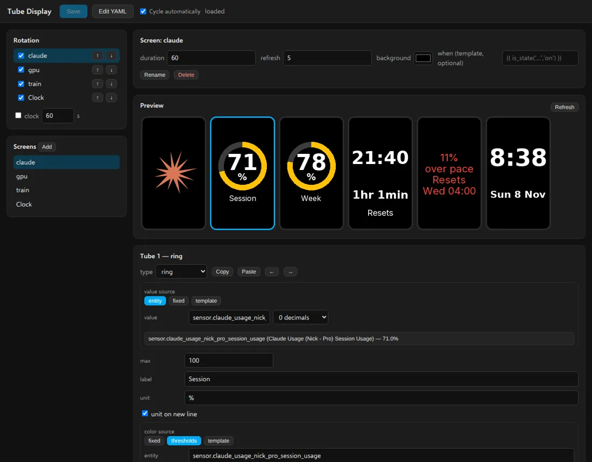

# Tube Display

Renders information from Home Assistant into pictures and pushes them to an
IPSTube clock — six 135x240 colour IPS displays in a row on an ESP32 — so the
clock can show dashboards, gauges, camera snapshots and more, rotating
between "screens" you design in a visual editor in the Home Assistant sidebar
(or in YAML).

The clock must run **[HA Tubes](https://github.com/nict41/HA-Tubes)**, the **panels firmware** (the firmware that accepts pushed
pictures on `POST /panel`); the stock time/date/weather firmware does not.

## How it works

1. You design screens in the **Tube Display** sidebar panel: a live six-tube
   preview, an entity picker, colour thresholds, icon autocomplete, your
   own pictures (any size: drag and zoom them into place) and a drag-and-drop
   designer for tubes with your own layout. They're saved in `tube_display/screens.yaml` in your Home
   Assistant config folder, which you can also edit by hand. Each screen is
   either six widgets — one per tube, left to right — or one 810x240 "strip"
   picture across all tubes.
2. The app renders the active screen to an 810x240 image, converts it to
   RGB565 and POSTs each 135x240 tube to `http://<clock>/panel?tube=N`.
   Only tubes whose picture changed are re-sent; tubes the clock reports as
   lost (`panels_needed` over MQTT, e.g. after the screen saver) are re-sent
   immediately.
3. A rotation cycles through the screens in `rotation:`, honouring each
   screen's `duration`, `refresh` and optional `when` condition. The special
   rotation entry `clock` hands the tubes back to the clock's own time
   display.
4. The clock's button shows the next screen while panels are showing. With
   **Cycle automatically** off, screens change only when you press it.
5. Screens update live: every template is subscribed over Home Assistant's
   websocket, so a value changes on the tubes as soon as it changes in HA.
6. Automations use the bundled integration's actions
   (`tube_display.show_screen`, `flash_message`, `pause`, ...) or the HTTP
   API, and MQTT entities (screen select, rotation and pause switches,
   message text, next-screen button, current screen, clock online) appear
   under the device "Tube Display".
7. Widgets for history graphs, progress with an ETA, weather, an analogue
   clock, a scrolling ticker and animated GIFs (played by the clock itself),
   ten fonts plus your own, free designs across all six tubes, transitions,
   and a gallery of ready-made screens with a setup wizard.
8. Night mode sets the clock's brightness from the sun and dims the screens,
   with optional quiet hours; new HA Tubes firmware releases are offered to
   the clock as a Home Assistant update; and one app can drive several
   clocks.

See [DOCS.md](DOCS.md) for the full reference: options, the screen editor,
the screens.yaml format with every widget, your own pictures, the clock's
button, actions, several clocks, night mode, firmware updates, the HTTP API,
the MQTT entities and an example automation.

## Requirements

- An IPSTube (or EleksTube-style) clock on the network running
  [HA Tubes](https://github.com/nict41/HA-Tubes) 2.3.0 or later (2.4.0 for faster pictures and GIFs), and its MQTT id
  (shown on the clock's Info and MQTT pages).
- The MQTT broker service enabled in Home Assistant (the app uses the
  broker the Supervisor injects; no credentials are stored in the app).
- `homeassistant_api: true` (already set) so templates, history and camera
  snapshots can be fetched through the Supervisor.
